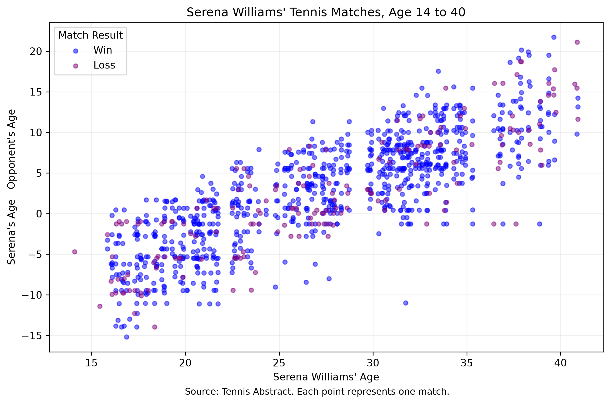

---
title: "Serena Williams Career Match Analysis"
project:
  render:
    - report.qmd
  output-dir: outputs
format:
  html: default
  pdf:
    pdf-engine: pdflatex
---

## Introduction

This project analyzes Serena Williams' career tennis matches using data from Tennis Abstract. The goal is to examine how the age difference between Serena Williams and her opponents changed throughout her career, and how this relates to match outcomes.

## Visualization

## Discussion

The scatterplot displays Serena Williams' age on the horizontal axis and the difference between her age and her opponent's age on the vertical axis.

Blue points represent wins, while purple points represent losses.

The graph shows a clear upward trend in age difference as Serena progresses through her career. Early in her career, Serena primarily competed against older opponents. Later in her career, she increasingly competed against younger opponents.

## Data Source

Tennis Abstract: Serena Williams Career Matches

https://www.tennisabstract.com/cgi-bin/wplayer-classic.cgi?p=SerenaWilliams&f=Acareerqq
